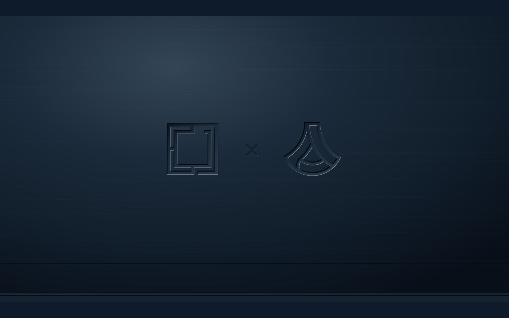
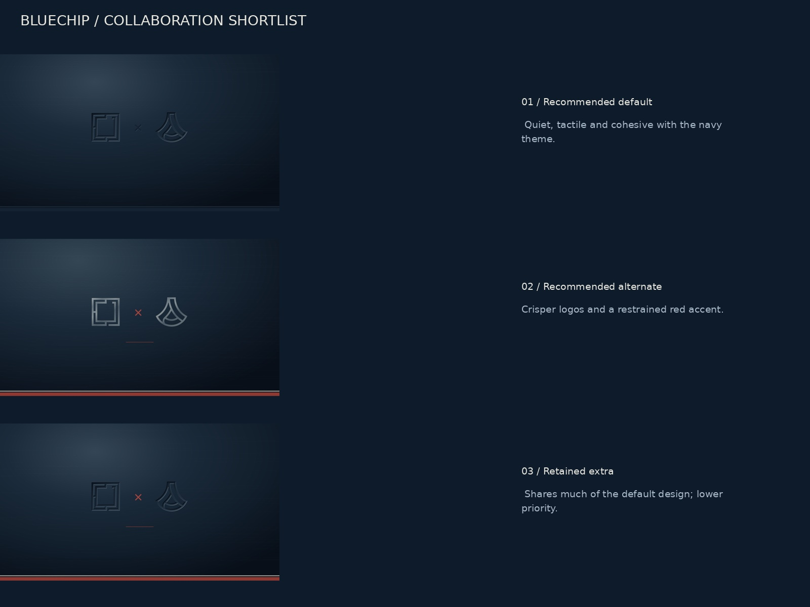

<h1 align="center">BlueChip</h1>

<p align="center">Pressed steel and faded Americana for Omarchy Quattro.</p>

<p align="center"><a href="https://github.com/tcballard/omarchy-badges"></a></p>



A dark navy theme with warm ivory text, steel-blue accents and ten 8K wallpapers, plus an optional aviation extra. The default puts the Omarchy × Anduril symbols into one monochrome metal surface, including the ×, underline and trim. The image above is artwork, not a live desktop screenshot.

## Install

On Omarchy Quattro:

```bash
omarchy-theme-install https://github.com/tcballard/omarchy-theme-bluechip
```

Back up any existing BlueChip theme and note your current theme/background first: Omarchy's installer applies the new theme. With this repository name, Omarchy installs it as `theme-bluechip` (shown as Theme Bluechip in some pickers). Use the background picker to choose another image. To roll back, select your previous theme; preserve local edits before removing BlueChip.

## Wallpapers

- Pressed Metal — Monochrome (default)
- Collaboration — Pressed Metal
- Collaboration — Laser Etched
- Omarchy — Flag Cutout
- Maximum Freedom
- Second Shift
- Old Glory — Faded
- Old Glory — Pressed Metal
- Old Glory — Blueprint
- Old Glory — Laser Etched

The quality-95 WebP wallpapers total 47.1 MB across all eleven designs. The ten theme wallpapers are 8192 × 5120 (16:10), preserving the composition and navy padding. Logo designs were rerendered from SVG; scenes received two contextual enhancement passes. Added detail is AI-reconstructed, with softer source regions retained where edits were unreliable. [Processing notes and prompts](docs/upscale/README.md) · [Dimensions and checksums](docs/wallpaper-manifest.json). Terminal errors, warnings and syntax retain distinct semantic colours for readability. No monitor scaling or keyboard shortcuts are changed.

## Eagle entrance

[Watch the five-second preview](docs/previews/bluechip-eagle-swoop-preview.mp4). Maximum Freedom has a roughly three-second 2D eagle swoop that settles into the static wallpaper. The smoke is painted artwork, not a particle simulation.

The matching clip is `backgrounds/intros/04-maximum-freedom.mp4`. Omarchy builds with native background intros resolve it automatically and respect disabled animations/intros. Older builds can use the WebP independently. Actual XPS playback remains untested; no custom startup hook is installed.

## Optional aviation wallpaper

[Stars and Stripes Flight](optional/10-stars-and-stripes-flight.webp) is 8192 × 4608 (16:9). It stays outside the default wallpaper rotation. To include it after installing:

```bash
cp ~/.config/omarchy/themes/theme-bluechip/optional/10-stars-and-stripes-flight.webp ~/.config/omarchy/themes/theme-bluechip/backgrounds/
```

Reselect the theme to refresh its staged backgrounds. The photograph was supplied by Tom; added detail is interpretive. See [credits](CREDITS.md).

## Collaboration shortlist

Monochrome pressed metal remains the default; laser etched is the recommended alternate. Coloured pressed metal remains available.



## Compatibility

Built against Quattro 4.0.0.alpha at `b79c846e364aa71c708d7671afa9fb07026cde5e`. Headless staging, all 20 stock template outputs, JSON/TOML parsing and Git-installed staging parity passed. Live XPS/desktop acceptance remains **not run**. See [validation](docs/VALIDATION.md) and [acceptance evidence](docs/ACCEPTANCE.json).

The palette uses Omarchy's stock app templates; Yaru-blue icons must already be installed. GTK appearance follows Omarchy's dark-mode integration. Personal template overrides can affect the result.

## Development and credits

Run `./tests/run`. [Development](docs/DEVELOPMENT.md) · [Architecture](ARCHITECTURE.md).

Concept direction by Tom Ballard; prepared with ChatGPT. Built from [Build Omarchy Themes](https://github.com/tcballard/build-omarchy-themes) guidance and the [Omarchy theme starter](https://github.com/tcballard/omarchy-theme-template). [Artwork provenance and logo sources](CREDITS.md).

Personal concept theme; not an official BlueChip, Omarchy or Anduril collaboration release. [MIT](LICENSE) applies to project code; third-party marks retain their respective rights. No blanket media licence is asserted.
