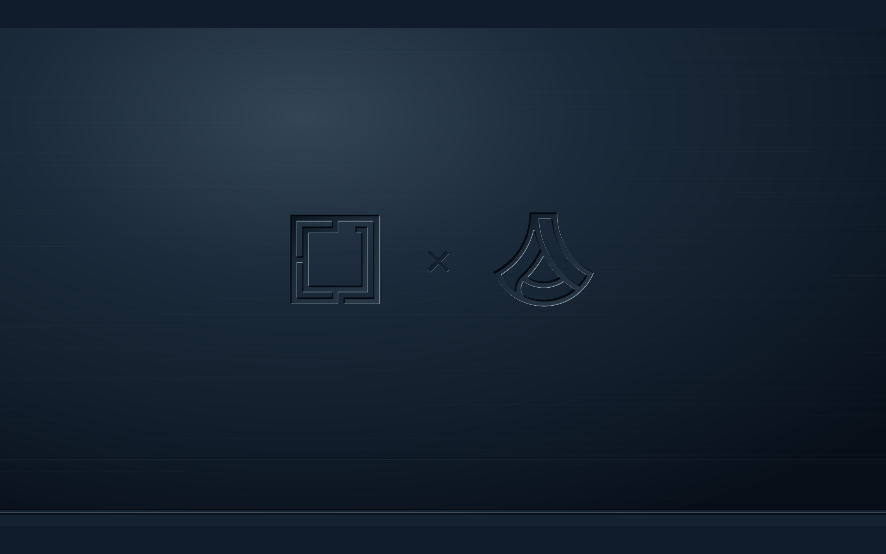

<h1 align="center">BlueChip</h1>

<p align="center">Pressed steel and faded Americana for Omarchy Quattro.</p>

<p align="center"><a href="https://github.com/tcballard/omarchy-badges"></a></p>



A dark navy theme with warm ivory text, steel-blue accents and ten wallpapers. The default puts the Omarchy × Anduril symbols into one monochrome metal surface, including the ×, underline and trim. The image above is artwork, not a live desktop screenshot.

## Install

On Omarchy Quattro:

```bash
omarchy-theme-install https://github.com/tcballard/omarchy-theme-bluechip
```

Back up any existing BlueChip theme and note your current theme/background first: Omarchy's installer applies the new theme. With this repository name, Omarchy installs it as `theme-bluechip` (shown as Theme Bluechip in some pickers). Use the background picker to choose another image. To roll back, select your previous theme; preserve local edits before removing BlueChip.

## Wallpapers

- Pressed Metal — Monochrome (default)
- Collaboration — Pressed Metal
- Collaboration — Laser Etched
- Omarchy — Flag Cutout
- Maximum Freedom
- Second Shift
- Old Glory — Faded
- Old Glory — Pressed Metal
- Old Glory — Blueprint
- Old Glory — Laser Etched

All images are padded to 16:10 without cropping or enlargement. The four logo compositions are 3840 × 2400; the six generated scenes are 1672 × 1045. Terminal errors, warnings and syntax retain distinct semantic colours for readability. No monitor scaling or keyboard shortcuts are changed.

## Compatibility

Built against Quattro 4.0.0.alpha at `b79c846e364aa71c708d7671afa9fb07026cde5e`. Headless staging, all 20 stock template outputs, JSON/TOML parsing and Git-installed staging parity passed. Live XPS/desktop acceptance remains **not run**. See [validation](docs/VALIDATION.md) and [acceptance evidence](docs/ACCEPTANCE.json).

The palette uses Omarchy's stock app templates; Yaru-blue icons must already be installed. GTK appearance follows Omarchy's dark-mode integration. Personal template overrides can affect the result.

## Development and credits

Run `./tests/run`. [Development](docs/DEVELOPMENT.md) · [Architecture](ARCHITECTURE.md).

Concept direction by Tom Ballard; prepared with ChatGPT. Built from [Build Omarchy Themes](https://github.com/tcballard/build-omarchy-themes) guidance and the [Omarchy theme starter](https://github.com/tcballard/omarchy-theme-template). [Artwork provenance and logo sources](CREDITS.md).

Personal concept theme; not an official BlueChip, Omarchy or Anduril collaboration release. [MIT](LICENSE) applies to project code; third-party marks retain their respective rights. No blanket media licence is asserted.
